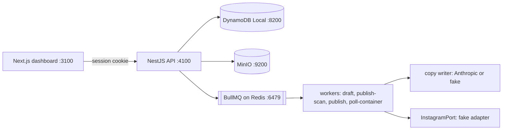

# 🤖 IntaBot

> Self-hosted, agentic Instagram management for a small number of Business accounts.

**An operator dashboard and API that turn an uploaded image into a drafted caption in a free posting slot, wait for human approval, then publish through a state machine that defaults to dry run. Everything runs against local services and a fake Instagram adapter; the real Meta integration is not built yet.**

<!-- readme-header -->
     

## What it does

- **Accounts and operators.** Operators sign in with a session cookie (`POST /auth/login`). Accounts are managed through `/accounts`. Account tokens are encrypted with AES-256-GCM (`TokenCryptoService`) and never returned or logged in plaintext.
- **Upload.** The dashboard uploads a JPEG, validated and stored in MinIO.
- **Drafting.** A BullMQ worker writes a caption and picks the next free posting slot. Slots are wall-clock windows in the account's timezone, with a minimum lead time and a collision gap so two posts do not land together. Captions come from `AnthropicCopyWriter` when `ANTHROPIC_API_KEY` is set and from a deterministic `FakeCopyWriter` otherwise.
- **Approval queue.** Drafted posts appear at `/approvals`, where the operator edits the caption and approves or rejects.
- **Publishing.** A scan job finds due approved posts and enqueues publish jobs, with the post version in the job id so a re-approved post can publish again but a duplicate scan cannot double-enqueue. A poll job waits on the media container with a timeout. Accounts default to `dryRun: true`: the full state machine runs and stops short of Instagram, and dry-run posts carry an `igMediaId` starting `dryrun-`.
- **Instagram boundary.** All Instagram access goes through `InstagramPort`. Only `FakeInstagramAdapter` exists, which is what the tests and dry-run use.

## Architecture



Entities are defined once as zod schemas in `packages/shared`, and repositories parse on read. Writes are conditional and versioned.

## Quickstart

Needs Node 22+, pnpm 9+, and Docker (DynamoDB Local, Redis, MinIO).

```bash
cp .env.example .env
node -e "console.log(require('crypto').randomBytes(32).toString('base64'))"
# paste the output into TOKEN_ENCRYPTION_KEY in .env

pnpm install
pnpm infra:up
pnpm --filter @intabot/api run create-user you@example.com <password>
pnpm dev     # API on :4100, dashboard on :3100
```

`create-user` creates the DynamoDB tables if needed, so it is safe as the first command against a fresh stack. Open <http://localhost:3100> and sign in.

To try the content loop: open `/upload`, pick an account and upload a JPEG; the drafted post appears at `/approvals` within a few seconds; edit the caption if you like and approve it.

| Service | Port |
| --- | --- |
| API | 4100 |
| Dashboard | 3100 |
| DynamoDB Local | 8200 |
| Redis | 6479 |
| MinIO (API / console) | 9200 / 9201 |

Ports are remapped away from the defaults because other local projects use them (API moved off 4000). Change them in `.env` and `docker-compose.yml` together.

## Configuration

Names from `.env.example`: `NODE_ENV`, `PORT`, `AWS_REGION`, `AWS_ACCESS_KEY_ID`, `AWS_SECRET_ACCESS_KEY`, `DYNAMO_ENDPOINT`, `DYNAMO_TABLE_MAIN`, `DYNAMO_TABLE_CHECKPOINTS`, `REDIS_URL`, `S3_ENDPOINT`, `S3_BUCKET`, `S3_ACCESS_KEY`, `S3_SECRET_KEY`, `TOKEN_ENCRYPTION_KEY`, `SESSION_TTL_HOURS`, `META_APP_ID`, `META_APP_SECRET`, `META_WEBHOOK_VERIFY_TOKEN` (unused so far), `WEB_ORIGIN`, `API_BASE_URL`, `ANTHROPIC_API_KEY` (optional).

## Test

```bash
pnpm test          # everything; requires `pnpm infra:up`
pnpm test:watch
pnpm typecheck
```

Integration tests run against DynamoDB Local; each Vitest worker gets its own table (`intabot_main_test_w<N>`) and its own queue prefix, so concurrent files cannot clobber each other. All Instagram calls use `FakeInstagramAdapter`, so no Meta credentials are needed. There is no CI workflow in this repo, so none of this runs automatically.

## Project layout

```
apps/api         NestJS: auth, accounts, media, content, approvals, posts, jobs, instagram port
apps/web         Next.js dashboard: login, upload, approvals
packages/shared  zod entity schemas
docs/superpowers specs and plans for each phase
```

Conventions worth knowing: write `@Inject(Token)` explicitly in Nest constructors, because esbuild (Vitest, tsx) does not implement `emitDecoratorMetadata` and type-based injection silently yields `undefined`. Nothing outside `apps/api/src/instagram/` should know Instagram exists.

Design: [overall](docs/superpowers/specs/2026-08-14-intabot-design.md), [Phase 2 content agent](docs/superpowers/specs/2026-08-15-intabot-phase-2-content-agent-design.md), [Phase 3 moderation](docs/superpowers/specs/2026-08-21-intabot-phase-3-moderation-design.md). Plans are in `docs/superpowers/plans/`.

## Status

Private prototype on the `feat/phase-2-content-agent` branch, which is the default branch.

- [ ] Phase 0: Meta app setup (manual; not done)
- [x] Phase 1: foundation
- [x] Phase 2: Content Agent
- [ ] Phase 3: Moderation Agent (design and plan written, not built)
- [ ] Phase 4: Analytics
- [ ] Phase 5: hardening and deploy

No real Instagram publishing, no webhooks, no comment moderation yet. No CI workflow and no LICENSE file.
